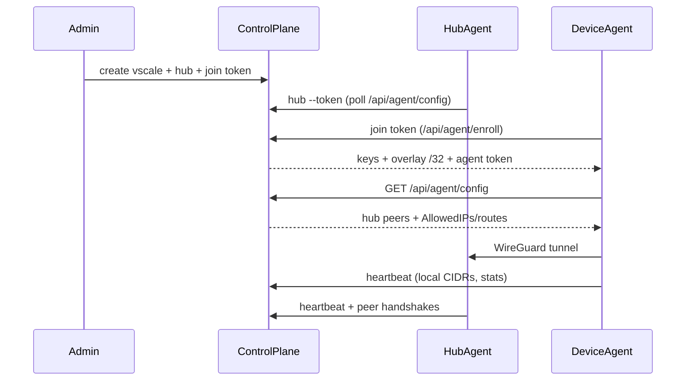

# Vscale architecture

Vscale is a self-hosted **hub-and-spoke** VPN control plane. Devices run the `vscale` agent and connect over WireGuard to one or more **hubs** (typically VPS nodes). The control plane assigns overlay IPs, join tokens, routes, and exposes an admin API/UI.

## Components

| Component | Binary / image | Role |
|-----------|----------------|------|
| Control plane | `vscale-control-plane` | REST API, auth/RBAC, IP allocator, topology |
| Postgres | `postgres:15` | Durable state |
| Admin web | `vscale-web` | Dashboard, vscales, devices, topology map |
| Agent (client) | `vscale` | Enroll, bring tunnel up/down, heartbeat, status |
| Agent (hub) | `vscale hub` | Same binary; listens for peers and syncs config |

## Data flow

## Domain model

- **Vscale** — overlay network with a dedicated CIDR inside `10.66.0.0/16` (default)
- **Hub** — WireGuard endpoint for a vscale (public endpoint + listen port)
- **Device** — enrolled agent with overlay `/32`
- **Membership** — user role inside a vscale (`owner` / `admin` / `member`)
- **JoinToken** — enroll credential (one-shot or reusable, expiry, uses)
- **Route** — advertised LAN/service CIDR via hub or device (pending/approved)
- **IpAllocation** — canonical ledger used by the allocator for anti-overlap

## Trust model (MVP)

- Users authenticate with JWT (admin/operator/member).
- Agents authenticate with `X-Vscale-Token` (device or hub).
- WireGuard keys are generated server-side at enroll/hub create; private keys are returned once to the agent and stored in agent state (`~/.config/vscale/state.json`).
- No mesh, DERP, or MagicDNS in this version — connectivity requires reachability to hub UDP endpoints.

## Hub sync

Hubs poll `/api/agent/config` (and send heartbeats). Peer changes are applied with `wg-quick` / `wg syncconf` when available — **no container recreate** for each peer.

## Threat notes

- Protect `JWT_SECRET`, DB credentials, and hub/device agent tokens.
- Expose the API over TLS in production (reverse proxy).
- Rotate join tokens; revoke compromised devices.
- Overlay uses CGNAT space to reduce collisions with typical LAN ranges; advertised routes still require approval and conflict checks.
